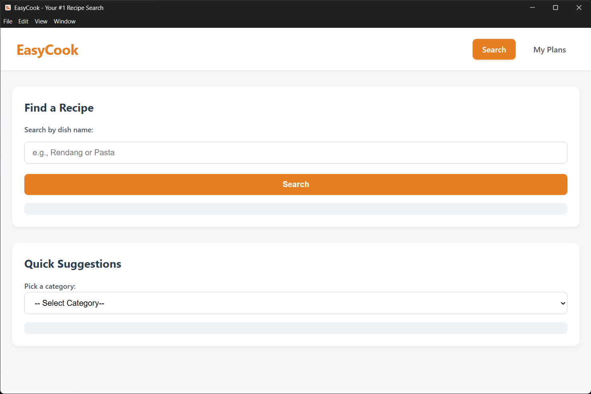
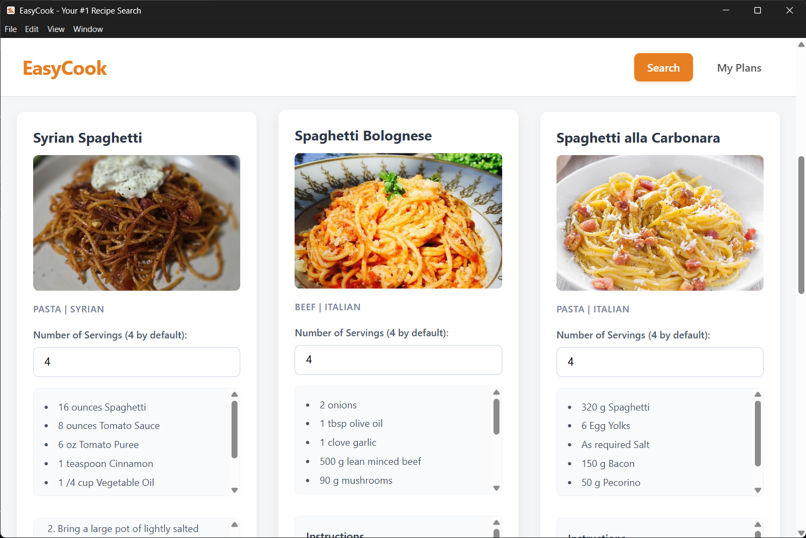
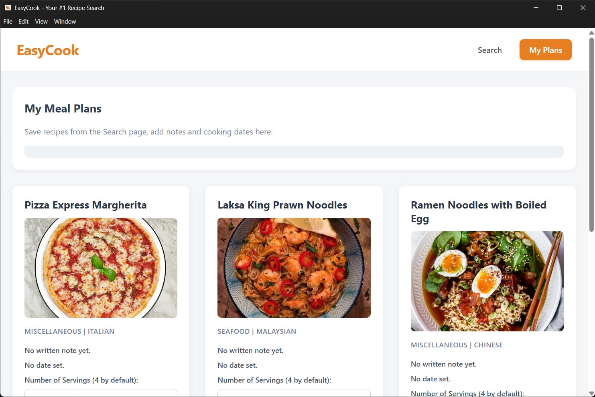
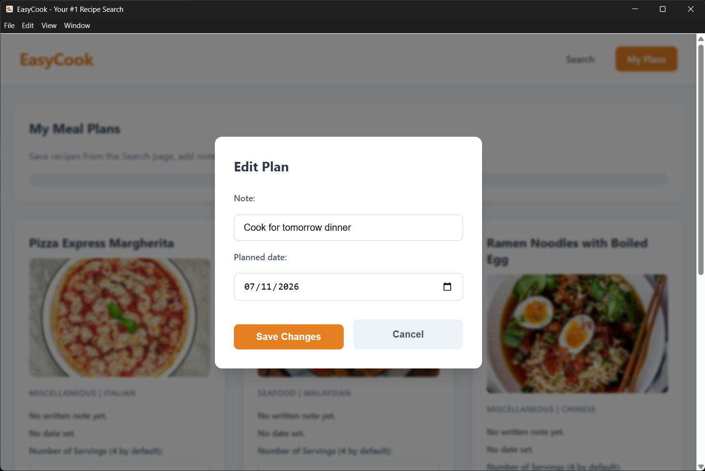

# EasyCook

A simple recipe dictionary desktop application built with Electron.

## Features

* **Recipe Search:** Retrieves and displays the searched recipe information.
* **Recipe Categories Suggestions:** Suggests suitable recipes based on selected
  categories.
* **Calculate Required Ingredients by Servings:** Calculates the required
  ingredients based on the given number of servings.
* **Meal Plans CRUD Operations:** Create, view, update, and delete locally
  stored meal plans through JavaScript localStorage.

## Screenshots

## Author

* **Name:** Muhammad Luthfi bin Mohd Mukhriz <<https://mkluth.github.io>>
* **Course:** Object Oriented Programming (CSC2923) Final Project

## Acknowledgement

* [Electron Documentation](https://www.electronjs.org/docs/latest/)
* [TheMealDB API](https://www.themealdb.com/documentation)
* [Google HTML/CSS Style Guide](https://google.github.io/styleguide/htmlcssguide.html#html-style-rules)
* [Google TS/JS Style Guide](https://google.github.io/styleguide/tsguide.html)

## License

This project is licensed under MIT License. See `LICENSE` for more information.
